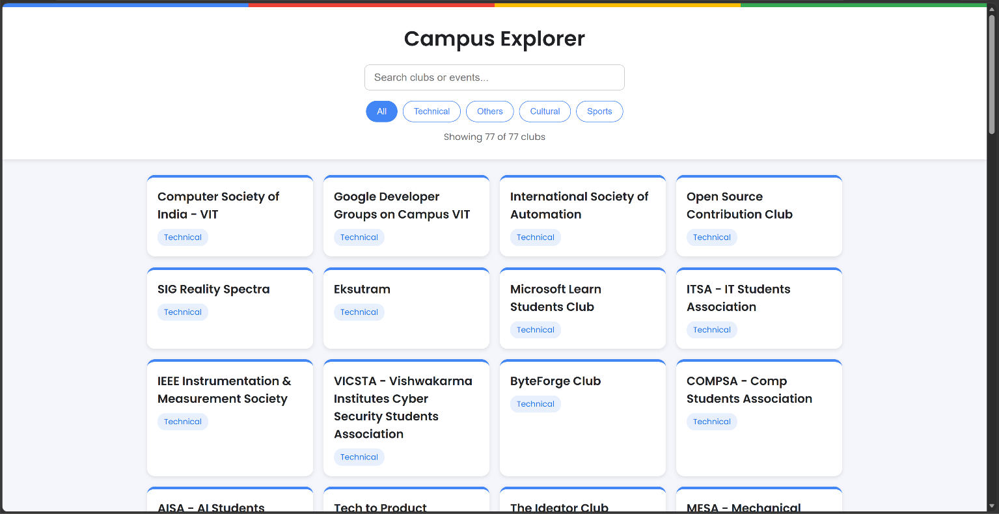

# Campus Explorer

A responsive website to explore the student clubs at VIT Pune.

**Live demo:** https://vedantbadge123-hub.github.io/campus-explorer/

## Features
- Search clubs by name
- Filter by category (Technical, Others, Cultural, Sports)
- Click a card to see its faculty mentor
- Shows how many clubs match ("Showing X of 77 clubs")
- Responsive layout for mobile and desktop

## Built with
HTML, CSS and JavaScript (no frameworks)

## How to run
Download or clone the repo and open `index.html` in a browser.

## What I learned
Event delegation, DOM manipulation, array methods (`filter`, `map`), CSS Grid and Flexbox, and deploying with GitHub Pages.